# UML diagrams

Ten diagrams of the application as built, plus the proposed deployment. Each `.html` file is the source: open it in a browser. Each `.svg` is exported from it, and is what GitHub and Obsidian show below.

They were drawn with the [diagram-design](https://github.com/cathrynlavery/diagram-design) skill (v2.6.164, default style) from the code and `ARCHITECTURE.md`. Where a diagram and the code disagree, the code is right.

| Diagram | UML kind | What it shows | Read with |
|---|---|---|---|
| [Use cases](use-cases.html) | Use case | The 12 user stories, grouped in 6 use cases, linked to the lowest role that performs each | `docs/prd.md` |
| [Components](components.html) | Component | The modular monolith: one FastAPI process and what sits outside it | `ARCHITECTURE.md`, Modular monolith |
| [Compose](deployment-compose.html) | Deployment | The Docker Compose stack as built, with ports, volumes and start order | `docker-compose.yml` |
| [Azure](deployment-azure.html) | Deployment | The Azure Container Apps proposal. **Not deployed** | `ARCHITECTURE.md`, Deployment |
| [Domain model](class-model.html) | Class | The six persisted classes, their multiplicities and constraints | `app/db/models.py` |
| [Booking attempt](state-booking-attempt.html) | State machine | `unknown`, `pending`, `confirmed`, `failed`, `rejected`, and the monotonic rule | `app/domain/booking.py` |
| [Document job](state-document-job.html) | State machine | `waiting`, `in_progress`, `complete`, `failed`, and the lease fence | `app/services/documents.py` |
| [Booking](sequence-booking.html) | Sequence | Commit before the POST, the provider's answer, the reconciler, and UI polling | `app/services/booking.py` |
| [Assistant](sequence-assistant-mcp.html) | Sequence | The assistant reaching the app only through MCP, with the caller's own token | `app/assistant/assistant.py` |
| [Add an item](activity-itinerary-write.html) | Activity | The optimistic lock on an itinerary write, and every 409 it can answer | `app/services/itinerary.py` |

## What the diagrams leave out

Each diagram stays within the skill's budget of about nine nodes, so some detail is in the code only:

- **Domain model:** `id` and foreign key columns, and plumbing fields such as `lease_until`, are shown as `+ …`. The enumerations are a key panel, not boxes.
- **Booking sequence:** only the main provider outcomes are drawn. The full outcome table is `from_post` in `app/domain/booking.py`, and the refusals before the insert are in `_open` in `app/services/booking.py`.
- **Assistant sequence:** Services and the provider share one lifeline, and the deterministic mode's `get_trip` call is in the note, not drawn.
- **Add an item:** every exit goes to one response node, with its code on the arrow. Provider failures of `GET /offers/{offerId}` (`OFFER_GONE`, 429, 502, 503) are not drawn.
- **Azure:** it has seven infrastructure nodes, one over the deployment type's cap, to keep the pipeline and the secrets in one picture.

## Use cases



## Components



## Deployment, Docker Compose



## Deployment, Azure (proposed, not deployed)



## Domain model



## Booking attempt states



## Document job states



## Booking with reconciliation



## Assistant through MCP



## Add an itinerary item



## Regenerate

Edit the `.html` file, then from the skill's directory run the checks and the export:

```bash
python scripts/self_check.py <file.html>
python scripts/verify_geometry.py <file.html>
python scripts/export_svg.py <file.html>
```
